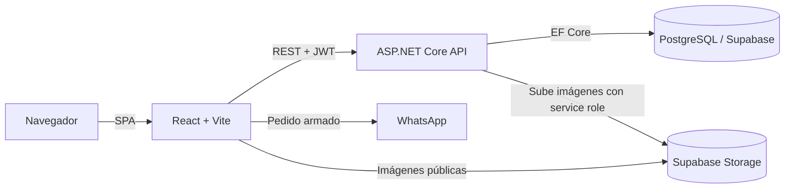

# DePasoAlimentos

Aplicación web full stack para un comercio de comidas congeladas y listas para cocinar. El cliente recorre el catálogo, arma su pedido y lo envía por WhatsApp para coordinar el retiro. El comercio administra productos, promociones, sugerencias y horarios desde un panel protegido.


## Por qué existe

Un comercio chico necesita mostrar su catálogo actualizado y recibir pedidos sin pagar una plataforma de e-commerce. DePasoAlimentos resuelve eso con un flujo simple: la web arma el pedido y lo deja listo para enviarlo por WhatsApp. No hay pago online: el cliente elige efectivo o transferencia y lo coordina con el comercio al retirar. El dueño mantiene el control del catálogo, los precios y los horarios desde su propio panel.

## Características

**Sitio público**

- Catálogo de productos con filtro por categoría (pastas, panificación, lácteos, salsas, comidas preparadas, etc.).
- Secciones de promociones y de sugerencias de comidas, con vista de detalle.
- Carrito persistido en el navegador, con nombre, forma de pago, detalle de retiro y aclaraciones.
- Envío del pedido por WhatsApp con un mensaje ya armado: ítems, cantidades y total aproximado.
- Horarios de atención semanales con hasta dos turnos por día, más días especiales para feriados o cierres imprevistos.

**Panel de administración** (`/admin`)

- Login con JWT y cambio de contraseña.
- Alta, edición, baja y activación/desactivación de productos y promociones.
- Publicación y despublicación de sugerencias de comidas.
- Carga de imágenes JPG/PNG a Supabase Storage a través de la API.
- Gestión de horarios semanales y días especiales, con validación de turnos.

## Stack tecnológico

| Capa | Tecnologías |
| --- | --- |
| Backend | ASP.NET Core Web API (.NET 10), Entity Framework Core 10, Npgsql |
| Autenticación | JWT Bearer, ASP.NET Core Identity `PasswordHasher` (PBKDF2) |
| Base de datos | PostgreSQL alojado en Supabase |
| Almacenamiento | Supabase Storage (bucket público de imágenes) |
| Frontend | React 19, TypeScript, Vite, Tailwind CSS 4 |
| Calidad | oxlint, Dependabot |
| Infraestructura | Docker (API), Vercel (frontend), GitHub Actions |

## Arquitectura

La solución .NET está dividida en capas con dependencias hacia el dominio. El frontend es una SPA independiente que consume la API REST.



| Proyecto | Responsabilidad |
| --- | --- |
| `DePasoAlimentos` | API: controllers, configuración de autenticación, CORS, rate limiting y headers de seguridad. |
| `DePasoAlimentos.Application` | DTOs de request/response, validaciones, interfaces y servicios con la lógica de negocio. |
| `DePasoAlimentos.Domain` | Entidades: `Product`, `Promotion`, `FoodSuggestion`, `BusinessHour`, `SpecialBusinessDay`, `AdminUser`. |
| `DePasoAlimentos.Infrastructure` | `AppDbContext`, migraciones, repositorios, seeders y el cliente de Supabase Storage. |
| `frontend` | Sitio público y panel de administración. |

Las entidades nunca se exponen ni se bindean directo desde el request: cada endpoint recibe y devuelve DTOs. Al iniciar, la API ejecuta seeders que crean los horarios semanales faltantes y el usuario administrador definido en la configuración.

## Estructura del proyecto

```text
DePasoAlimentos/
├── DePasoAlimentos/                  # API ASP.NET Core
│   ├── Controllers/
│   └── Program.cs
├── DePasoAlimentos.Application/
│   ├── DTOs/
│   ├── Interfaces/
│   ├── Services/
│   └── Validation/
├── DePasoAlimentos.Domain/
│   └── Entities/
├── DePasoAlimentos.Infrastructure/
│   ├── Data/                         # DbContext, migraciones y seeders
│   ├── Repositories/
│   └── Services/                     # SupabaseImageStorageService
├── frontend/
│   ├── src/
│   │   ├── components/
│   │   ├── context/                  # Estado del carrito
│   │   ├── pages/                    # Panel de administración
│   │   ├── sections/                 # Secciones del sitio público
│   │   └── services/                 # Clientes de la API
│   └── vercel.json                   # Rewrites y headers de seguridad
├── .github/                          # Workflows y Dependabot
├── Dockerfile                        # Imagen de producción de la API
└── docker-compose.yml                # PostgreSQL local opcional
```

## Requisitos previos

- [.NET SDK 10](https://dotnet.microsoft.com/download)
- [Node.js](https://nodejs.org/) con npm
- Herramienta de EF Core: `dotnet tool install --global dotnet-ef`
- Una base PostgreSQL: un proyecto de Supabase o el contenedor de `docker-compose.yml`
- Un bucket público en Supabase Storage para las imágenes

## Instalación y configuración

### 1. Clonar el repositorio

```bash
git clone https://github.com/EnzoDalmasso/DePasoAlimentos.git
cd DePasoAlimentos
```

### 2. Configurar la API

Copiá `DePasoAlimentos/appsettings.Development.example.json` como `DePasoAlimentos/appsettings.Development.json` y completá los valores:

| Clave | Descripción |
| --- | --- |
| `ConnectionStrings:DefaultConnection` | Connection string de PostgreSQL. |
| `SupabaseStorage:Url` | URL del proyecto de Supabase (`https://<ref>.supabase.co`). |
| `SupabaseStorage:Bucket` | Nombre del bucket de imágenes. |
| `SupabaseStorage:ServiceRoleKey` | Service role key de Supabase. Solo vive en el backend. |
| `Jwt:Key` | Clave de firma de al menos 32 bytes. |
| `Jwt:Issuer` / `Jwt:Audience` | Emisor y audiencia de los tokens. |
| `SeedAdmin:Email` / `SeedAdmin:Password` | Credenciales del administrador que se crea al primer inicio. |

Con Supabase conviene usar el **Session Pooler**, porque la conexión directa solo funciona sobre IPv6:

```text
Host=<host-del-pooler>;Port=5432;Database=postgres;Username=<usuario>;Password=<password>;SSL Mode=Require;Trust Server Certificate=true
```

Para usar PostgreSQL local, copiá `.env.example` como `.env`, definí `POSTGRES_PASSWORD` y levantá el contenedor:

```bash
docker compose up -d
```

### 3. Aplicar las migraciones

```bash
dotnet ef database update --project DePasoAlimentos.Infrastructure --startup-project DePasoAlimentos
```

### 4. Configurar el frontend

Copiá `frontend/.env.example` como `frontend/.env.local`:

```env
VITE_API_BASE_URL=http://localhost:5139/api
```

Es la única variable del frontend. Todo lo que empieza con `VITE_` termina en el bundle público, así que nunca debe contener credenciales.

## Ejecución

API (queda en `http://localhost:5139`):

```bash
dotnet run --project DePasoAlimentos --launch-profile http
```

Frontend (queda en `http://localhost:5173`):

```bash
cd frontend
npm install
npm run dev
```

El panel de administración está en `http://localhost:5173/admin`.

Otros comandos:

| Comando | Uso |
| --- | --- |
| `dotnet build -c Release` | Compila la solución. |
| `npm run build` | Genera el build de producción del frontend. |
| `npm run lint` | Ejecuta oxlint sobre el frontend. |

> En PowerShell, si la política de ejecución bloquea `npm`, usá `npm.cmd`.

## API

Todos los endpoints requieren autenticación salvo los marcados como públicos. Los endpoints de administración exigen un JWT con rol `Admin` en el header `Authorization: Bearer <token>`.

### Autenticación

| Método | Ruta | Acceso |
| --- | --- | --- |
| POST | `/api/auth/login` | Público |
| PUT | `/api/auth/change-password` | Admin |

```http
POST /api/auth/login
Content-Type: application/json

{ "email": "admin@example.com", "password": "********" }
```

```json
{ "token": "eyJhbGciOi...", "email": "admin@example.com" }
```

### Productos y promociones

`/api/products` y `/api/promotions` exponen las mismas operaciones:

| Método | Ruta | Acceso |
| --- | --- | --- |
| GET | `/api/{recurso}` | Público (solo activos) |
| GET | `/api/{recurso}/{id}` | Público (solo activos) |
| GET | `/api/{recurso}/admin` | Admin (incluye inactivos) |
| POST | `/api/{recurso}` | Admin |
| PUT | `/api/{recurso}/{id}` | Admin |
| PATCH | `/api/{recurso}/{id}/activate` | Admin |
| PATCH | `/api/{recurso}/{id}/deactivate` | Admin |
| DELETE | `/api/{recurso}/{id}` | Admin |

### Sugerencias de comidas

| Método | Ruta | Acceso |
| --- | --- | --- |
| GET | `/api/foodsuggestions` | Público (solo publicadas) |
| GET | `/api/foodsuggestions/{id}` | Público (solo publicadas) |
| GET | `/api/foodsuggestions/admin` | Admin |
| POST | `/api/foodsuggestions` | Admin |
| PUT | `/api/foodsuggestions/{id}` | Admin |
| PATCH | `/api/foodsuggestions/{id}/publish` | Admin |
| PATCH | `/api/foodsuggestions/{id}/unpublish` | Admin |
| DELETE | `/api/foodsuggestions/{id}` | Admin |

### Horarios

| Método | Ruta | Acceso |
| --- | --- | --- |
| GET | `/api/store-hours` | Público |
| PUT | `/api/store-hours/weekly/{id}` | Admin |
| POST | `/api/store-hours/special-days` | Admin |
| PUT | `/api/store-hours/special-days/{id}` | Admin |
| DELETE | `/api/store-hours/special-days/{id}` | Admin |

### Imágenes

| Método | Ruta | Acceso |
| --- | --- | --- |
| POST | `/api/images/upload` | Admin |

Recibe `multipart/form-data` con `file` (JPG o PNG, máximo 5 MB) y `folder` (`products`, `promotions` o `food-suggestions`). Devuelve la URL pública de la imagen.

### Salud

`GET /` y `GET /health` son públicos y sirven para monitoreo.

## Seguridad

- **Autorización por defecto:** una fallback policy exige autenticación en todos los endpoints; los públicos se marcan de forma explícita con `[AllowAnonymous]`.
- **Sesiones cortas:** el JWT del administrador dura 30 minutos y el panel cierra la sesión al vencer.
- **Contraseñas:** se guardan hasheadas con PBKDF2 (`PasswordHasher` de ASP.NET Core Identity).
- **Fuerza bruta:** el login admite 5 intentos por minuto por IP y bloquea la cuenta 15 minutos después de 5 contraseñas incorrectas. Además hay un límite global de 120 requests por minuto por IP, calculado sobre la IP real detrás del proxy.
- **Validación de entrada:** DataAnnotations en todos los DTOs; las imágenes solo se aceptan si pertenecen al bucket propio, y las promociones validan el orden de sus fechas.
- **Subida de archivos:** lista blanca de tipos, verificación de magic bytes, límite de 5 MB, carpetas permitidas y nombres generados con GUID.
- **Base de datos:** Row Level Security activo en todas las tablas expuestas por Supabase; solo la API accede a los datos.
- **Credenciales:** la service role key y la connection string viven únicamente en la configuración del backend. Los archivos con secretos están excluidos de Git.
- **Transporte y headers:** HTTPS con HSTS en producción, CORS restringido al dominio del frontend, y headers `Content-Security-Policy`, `X-Frame-Options`, `X-Content-Type-Options`, `Referrer-Policy` y `Permissions-Policy` tanto en la API como en el sitio.

## Deploy

**Frontend:** se publica en Vercel desde la carpeta `frontend`. La variable `VITE_API_BASE_URL` debe apuntar a la API de producción. `vercel.json` define el rewrite de la SPA y los headers de seguridad; si cambian los dominios de la API o del bucket, hay que actualizar la CSP.

**API:** se construye con el `Dockerfile` incluido y escucha en el puerto `8080`. Variables requeridas:

```text
ASPNETCORE_ENVIRONMENT=Production
ConnectionStrings__DefaultConnection
SupabaseStorage__Url
SupabaseStorage__Bucket
SupabaseStorage__ServiceRoleKey
Jwt__Key
Jwt__Issuer
Jwt__Audience
SeedAdmin__Email
SeedAdmin__Password
```

Las migraciones no se aplican al iniciar la API: hay que ejecutarlas antes de deployar una versión que cambie el esquema.

### Automatizaciones

- **Supabase keep-alive** (`.github/workflows/supabase-keepalive.yml`): el plan gratuito de Supabase pausa los proyectos inactivos, así que este workflow escribe una fila diaria en `keepalive.pings`. Necesita el secret de Actions `SUPABASE_DB_URL` con la URI del Session Pooler.
- **Dependabot** (`.github/dependabot.yml`): abre PRs semanales con actualizaciones de NuGet, npm y GitHub Actions.

## Autor

**Enzo Dalmasso**

- GitHub: [EnzoDalmasso](https://github.com/EnzoDalmasso)
- Portfolio: [porfolio-enzo-dalmasso.vercel.app](https://porfolio-enzo-dalmasso.vercel.app/)

## Licencia

Distribuido bajo la licencia MIT. Ver [LICENSE](LICENSE).
